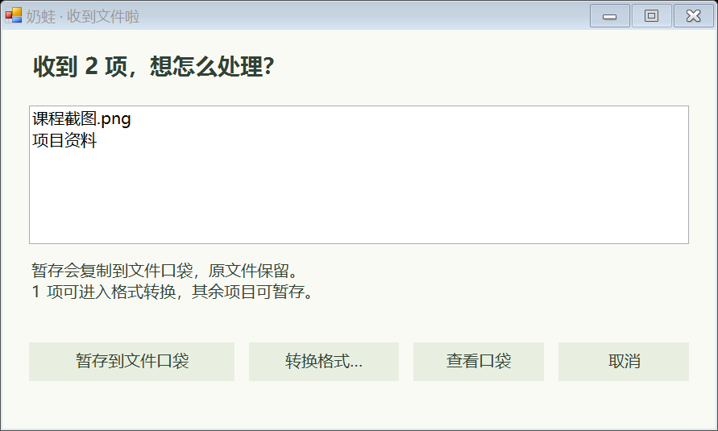
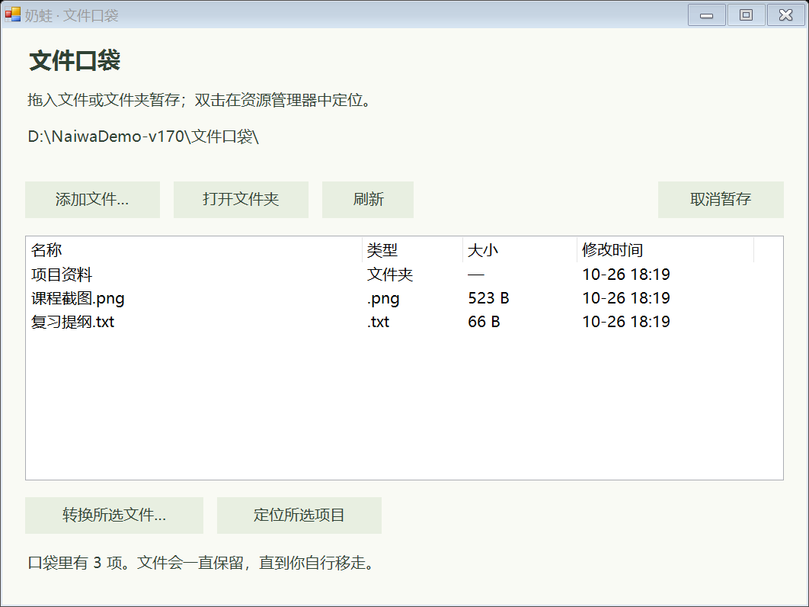
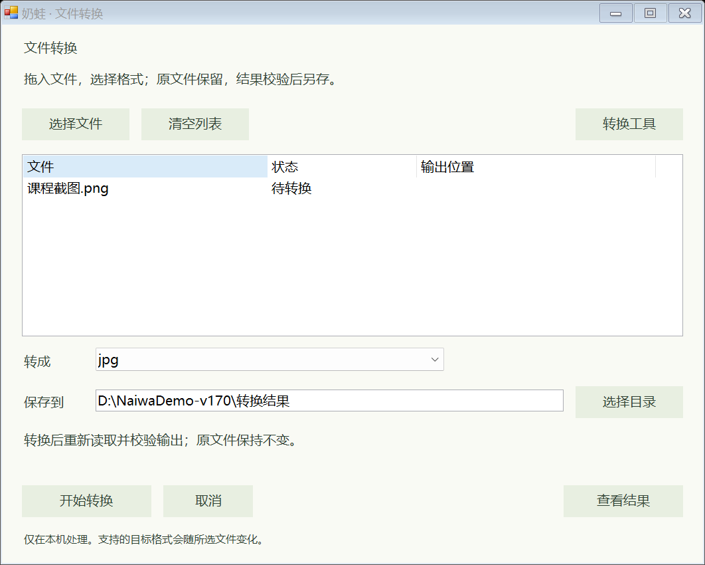
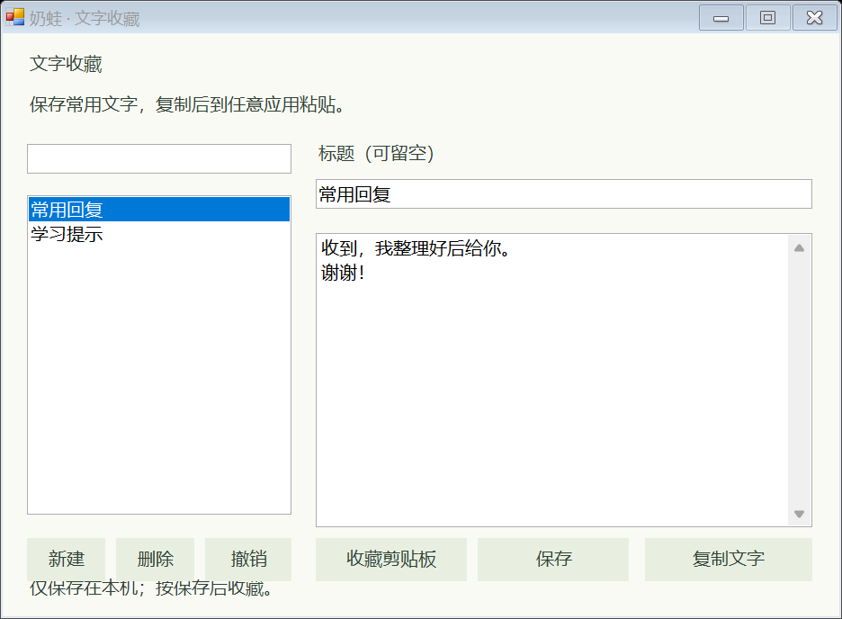
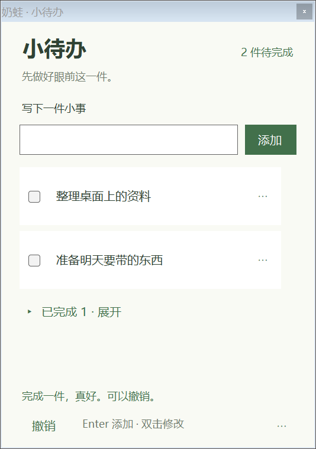
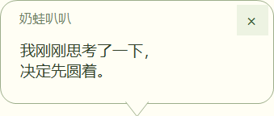

<div align="center">

# 奶蛙陪伴 · Naiwa Companion

**身外跟随，身上回正。按按脑袋，Q 弹回望。**

让立体奶蛙在 Windows 桌面安静陪伴：看着鼠标、戳肚子、拖动回弹，也能记待办、说两句、收藏文字、暂存文件和转换格式。

[](https://github.com/iloveqjh/naiwa-companion/releases/latest)
[](LICENSE)
[](https://github.com/iloveqjh/naiwa-companion/actions/workflows/build.yml)

**[下载 Windows 版](https://github.com/iloveqjh/naiwa-companion/releases/latest) · [使用指南](docs/使用指南.md) · [安装与修改入口](AI_GUIDE.md) · [更新记录](CHANGELOG.md)**


角色素材示例来自 [yugh6/Naiwa](https://github.com/yugh6/Naiwa)。程序实际外观由导入的素材决定。

</div>

## 三步开始

1. 下载最新发布中的 `NaiwaCompanion-Windows-v1.7.0.zip`，完整解压到喜欢的文件夹。
2. 双击 `NaiwaCompanion.exe`。首次缺少角色素材时，选择「下载并使用」或选择已有素材。
3. 奶蛙出现后，右键调整大小、声音、置顶、眼神跟随和主题。默认关闭声音，想听时勾选「动作声音」。

Windows 10 / 11 可直接运行，无需安装 Python、Node.js、模型或 API Key。升级前先退出桌宠，替换程序和文档，保留自己的素材、主题与设置。

**当前公开版 1.7.0** 包含小待办、说话气泡、文字收藏、文件转换和文件口袋。办公格式需本机 Microsoft Office，音视频和部分图片需 FFmpeg，PDF 处理需 Poppler；公开包不捆绑这些工具，可在「文件转换 → 转换工具」配置。详见 [转换工具配置](docs/转换工具配置.md)。

> 公开下载包包含程序和中文文档。经典素材由程序从原作者仓库下载；太极、天使、爬爬等个人录屏主题需要自行导入。下面的主题专属效果需要相应的新版主题包。

## 新功能图解

下图使用演示资料，不含个人文件和设置。点击图片可查看原图。

<table>
<tr>
<td width="50%"><strong>① 拖到奶蛙：选择暂存或转换</strong><br><br>将文件或文件夹拖到可见身体上，选择下一步。</td>
<td width="50%"><strong>② 文件口袋：查看实际目录内容</strong><br><br>复制暂存，原文件保留；同名另存，双击定位。</td>
</tr>
<tr>
<td width="50%"><strong>③ 文件转换：选格式、另存并校验</strong><br><br>支持 36 种输入扩展名、223 种明确组合；所需工具见配置说明。</td>
<td width="50%"><strong>④ 文字收藏：随手存、一键复制</strong><br><br>搜索常用文字、编辑内容，主动收藏剪贴板文字。</td>
</tr>
<tr>
<td width="50%"><strong>⑤ 小待办：先做好眼前这一件</strong><br><br>Enter 添加、勾选完成、双击修改，内容在本机保存。</td>
<td width="50%"><strong>⑥ 说话气泡：轻轻回应与提醒</strong><br><br>80 句原创文案、待办汇报、安静时段；语录为文字显示。</td>
</tr>
</table>

## 把文件交给奶蛙

1. 将文件或文件夹拖到奶蛙身上，选择「暂存到文件口袋」或「转换格式」。
2. 暂存会复制保存，保留原文件；文件夹保留子目录和空文件夹，复制后逐文件校验。
3. 右键奶蛙或托盘 →「文件口袋 · 查看暂存文件」，可刷新、打开文件夹、定位项目或继续转换。

口袋内容不会自动清空。默认保存在本机应用数据目录；可用 `storage.local.json` 把数据、口袋和默认转换结果放到自己选择的 D 盘目录。配置示例与迁移步骤见 [文件口袋](docs/文件口袋.md)。

## 桌面小待办

右键奶蛙或托盘打开小待办：Enter 添加、勾选完成、双击修改，支持单步撤销、删除、折叠及清空已完成。内容自动保存在本机，卡片记住位置并随奶蛙在全屏时隐藏和恢复。

使用方法、交互设计与文件保护见 [桌面小待办](docs/桌面小待办.md)。

## 说话、收藏与转换

新增互动小气泡、80 句原创文案、待办汇报和安静时段；本机文字收藏可搜索、编辑和一键复制到其他应用。文件转换支持常用办公、PDF、图片和音视频组合，校验结果后另存，保留原件。详见 [说话收藏与转换](docs/说话收藏与转换.md)。

1.6.1 完成转换范围核查并修复照片方向、XLS 超限、隐藏工作表与异常 CSV；实际支持 36 种输入扩展名、223 种组合，完整清单见 [格式支持与验证](docs/格式支持与验证.md)。

## 怎么玩

| 操作 | 奶蛙的反应 |
| --- | --- |
| 鼠标在身体外移动 | 眼睛轻柔跟随，上下左右都有缓动 |
| 鼠标移到身体上 | 视线缓缓回正，安静看着你 |
| 按住头部向下拉，再松手 | 整身压扁、向两侧鼓起，随后 Q 弹回摆并播放主题反应 |
| 单击肚子 | 经典、太极、天使的肚腹局部回弹 |
| 双击 | 播放当前动作；经典主题为约 14 秒完整大笑 |
| 笑倒后单击 | 恢复站立 |
| 拖动后松手 | 拎起时轻微倾斜，落下时回弹并保存位置 |
| 单击爬爬身体 | 开始或暂停持续爬行 |
| 全屏游戏或视频 | 自动隐藏并停止声音，返回桌面后恢复 |

横拉、上提头部仍是拖动。右键「按头回弹（演示）」可以直接观看；再次运行程序或双击托盘图标可以召回奶蛙。

## 四种主题，各有自己的反应

| 主题 | 日常动作 | 按头回弹后的参考编排 |
| --- | --- | --- |
| 经典奶蛙 | 眼神、眨眼、完整捧腹大笑 | 盯一眼，再自然眨眼 |
| 太极奶蛙 | 屈膝推掌待机；太极、合掌、招手 | 快速切到镜像经典站姿，注视约 **1.2 秒**，再快速回太极 |
| 天使奶蛙 | 光环、白色翅膀、神圣吟唱 | 连续合掌祈祷、收手复原 |
| 爬爬奶蛙 | 伸爪、撑地、后腿跟进，碰边折返 | 回头看看 → 趴着偷笑，结束后继续爬 |

当前参考包以经典奶蛙校准黄色，保留皮肤阴影、肚皮与白色翅膀；太极切换站姿时使用同一颜色基准。爬行使用完整正向步态，支持 60 fps；太极注视整段约 1.57 秒，其中停留约 1.2 秒。详细帧数、参数与制作方法见 [主题修订记录](docs/主题修订记录.md)。

主题包放入 `themes/主题名/theme.nct`，右键「切换主题」选择。太极与天使可循环当前动作；爬爬保持当前高度沿桌面左右爬行，菜单、按压、拖动和全屏期间暂停。它不会攀爬其他窗口。

## 动作有原声，待机安静陪伴

程序支持主题包中的匹配 WAV：经典笑声、太极配乐、天使吟唱与祈祷、爬爬偷笑。声音只随对应动作播放；待机与持续爬行安静。停止、切换动作、拖动、再次按压、隐藏或退出都会停止声音。

1.4.1 还增加了四周透明留白、按主题帧率刷新与完整动作校验，减少回弹裁切和中间姿势漏刷。透明空白可以点击穿透。

## 下载、校验与中文文档

- [Windows 下载页](https://github.com/iloveqjh/naiwa-companion/releases/latest)：下载程序 ZIP 和 SHA-256 文件。
- [使用指南](docs/使用指南.md)：安装、声音、主题、召回、升级与常见问题。
- [文件口袋](docs/文件口袋.md)：拖文件、查看列表、暂存和自定义存储目录。
- [说话、收藏与转换](docs/说话收藏与转换.md)：气泡、提醒、文字收藏和转换操作。
- [转换工具配置](docs/转换工具配置.md)：Microsoft Office、FFmpeg、Poppler 与功能要求。
- [格式支持与验证](docs/格式支持与验证.md)：完整转换方向、未支持格式与内容边界。
- [主题与动作](docs/主题与动作.md)：包结构、动作、颜色和音频字段。
- [主题修订记录](docs/主题修订记录.md)：当前参考主题的最终行为与制作参数。
- [开发指南](docs/开发指南.md)：源码结构、构建、测试和渲染。
- [验证记录](docs/验证记录.md)：本机检查与公开构建验证范围。
- [AI_GUIDE.md](AI_GUIDE.md)：统一的下载、安装和修改入口。

机器可读清单为 [release.json](release.json)，素材来源为 [assets-source.json](assets-source.json)。也可先下载 [Install.ps1](https://raw.githubusercontent.com/iloveqjh/naiwa-companion/main/scripts/Install.ps1)，查看后运行：

```powershell
.\Install.ps1 -Destination 'D:\NaiwaCompanion' -OriginalAssets -CreateShortcut -Launch
```

脚本会校验下载包；原版素材从原作者仓库获取。程序没有账户绑定、自动开机启动、全局键盘监听或后台上传，日常桌宠互动离线运行。

## 从源码构建

```powershell
.\scripts\Build.ps1
$p = Start-Process '.\dist\NaiwaCompanion.exe' -ArgumentList '--self-test test-output' -Wait -PassThru
Get-Content '.\test-output\results.txt'
if ($p.ExitCode -ne 0) { throw '测试失败' }
```

使用 C# 5 兼容语法和 Windows 自带的 .NET Framework 4.x 编译器。需要检查自己的主题时，为自测添加 `--assets "主题目录"`；按压预览使用 `--render-press "输出目录"`。

## 开源与素材来源

程序代码与中文文档采用 **MIT** 许可证，兼容素材格式与交互体验参考 [yugh6/Naiwa](https://github.com/yugh6/Naiwa)。角色图片、录屏、动作帧和音频属于外部素材，未包含在公开仓库和程序包内；说明见 [NOTICE.md](NOTICE.md) 与 [素材来源](docs/素材来源.md)。
