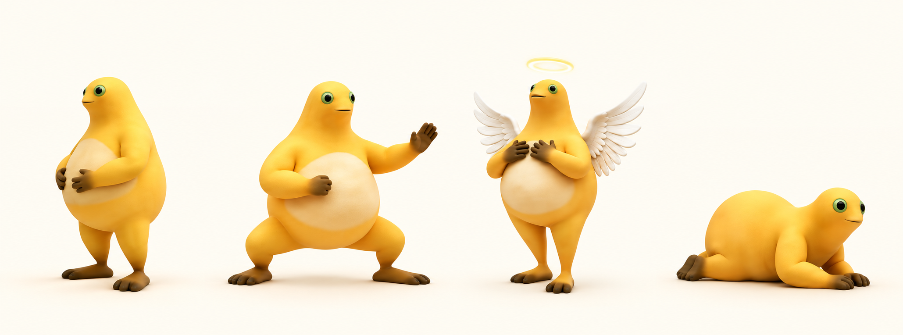

# 奶蛙陪伴 · Naiwa Companion

**鼠标在身外，眼睛轻柔跟随；鼠标移到身上，视线缓缓回正。**

一个轻量的 Windows 桌宠：保留圆眼睛、大肚子和立体黄皮肤，让奶蛙在桌面安静陪伴，也能打太极、展开翅膀，或一路爬到屏幕边缘再折返。按住头部往下压，整只奶蛙会被压扁、鼓起，松手后 Q 弹回摆，再用当前主题自己的神态回应你。程序使用 C# / .NET Framework 4.x，Windows 10 / 11 可直接运行。



上图为按角色参考制作的 AI 主题插画；桌宠实际外观由导入素材决定。经典素材可在程序内下载，另外三套个人录屏主题需自行导入。

**[下载 Windows 版](https://github.com/iloveqjh/naiwa-companion/releases/latest) · [中文使用指南](docs/使用指南.md) · [下载与修改入口](AI_GUIDE.md) · [开发指南](docs/开发指南.md)**

## 三步开始

1. 在下载页找到 `NaiwaCompanion-Windows-v1.4.0.zip`，解压到喜欢的位置，例如 `D:\NaiwaCompanion`。
2. 双击 `NaiwaCompanion.exe`，使用原版立体奶蛙素材。新版本首次缺少素材时会打开素材准备窗口。
3. 想使用原版奶蛙：右键桌宠 →「下载原版素材」→「下载并使用」，完成后自动切换。已有素材可右键导入；也可从 [原作者项目](https://github.com/yugh6/Naiwa) 下载 `素材.nwp`、`原版笑声.wav` 放到程序旁边。

已经装好原版的用户无需重新下载素材，在新程序的右键菜单里选择「导入原版素材」，选中原来的文件夹即可。

## 按头压扁，松手 Q 弹

鼠标按住奶蛙可见的头部，往下拉：身体会逐渐变矮、向两侧鼓起，脚底保持原位。压得越深，阻力越大，不会被无限压成一条线。松手后先略微弹高，再轻轻回摆并停稳，随后播放主题对应的短反应。

1.4 使用主题自己的真实动作帧：经典版盯一眼再自然眨眼；太极版随推掌侧目、收势回望；天使版短暂合掌祈祷后复原；新版爬爬包把回头看看与趴着偷笑连成完整片段，结束后继续爬。眼睛保留原素材形状和纹理。

横向或向上拖头部、拖动身体，仍然是移动奶蛙；单击肚子的局部回弹继续保留。右键「按头回弹（演示）」可直接观看。经典、太极、天使、爬爬都支持，爬爬在按压和表情期间停下，结束后继续爬。动作由现有角色素材形变完成，无需额外下载动作包。

## 主题：明亮立体，也真的会爬

将 `theme.nct` 放入程序旁的 `themes/主题名/` 文件夹，右键「切换主题」即可选择。程序支持下列主题行为；新版个人主题包使用经典奶蛙的明亮黄色作为校准参考，保留手脚和身体的立体阴影。

| 主题 | 玩法 |
| --- | --- |
| 经典奶蛙 | 保留原版眼神、眨眼与完整捧腹大笑，笑倒后可单击站起来 |
| 太极奶蛙 | 原“功夫奶蛙”；待机改为屈膝推掌起势，可选太极推掌、合掌致意、招手问好 |
| 天使奶蛙 | 光环、白色翅膀，支持神圣吟唱与合掌祈祷 |
| 爬爬奶蛙 | 真实步态帧配合桌面位移，持续爬行，碰到当前屏幕工作区边缘自动折返；单击身体开始或暂停 |

爬爬主题支持拖动换位置，松手后从新位置继续；右键菜单展开时暂停移动，全屏隐藏时停下，返回桌面后继续。它沿当前高度左右爬行，不攀爬其他窗口。

新主题保持原素材的立体外观，支持各自的眼部和肚腹区域校准。右键「选择动作」或双击播放当前动作；太极和天使可开启「循环当前动作」。爬行步态连续衔接，无需每轮停回待机。格式、颜色和移动参数见 [主题与动作](docs/主题与动作.md)。

外部角色和录屏素材包由用户自行导入，不包含在公开发布包中。程序缺少角色素材时会打开素材准备窗口，不会显示简笔替代形象。

透明窗口四周预留动作空间，奶蛙本身的显示比例不变；回弹和拖动倾斜不会再被紧贴身体的窗口边缘裁切。新版爬爬包只使用录屏中身体完整的步态帧。

## 怎么玩

| 操作 | 反应 |
| --- | --- |
| 鼠标在身体外移动 | 眼睛轻微跟随，上下左右都有效，距离越远逐渐达到自然上限 |
| 鼠标移到身体上 | 视线缓缓回正；移开后继续跟随 |
| 按住头部向下拉、松手 | 脚底不动，整身压扁鼓起；松手阻尼回弹，再播放主题专属短反应 |
| 不操作 | 随机间隔眨眼，静静陪伴 |
| 单击肚子 | 经典、太极、天使：肚腹局部压下回弹；爬爬：开始或暂停爬行 |
| 双击 | 播放当前动作；经典主题为约 14 秒完整大笑 |
| 笑倒后单击 | 恢复站立 |
| 拖动、松手 | 拎起时轻微倾斜，松手时回弹；位置会保存 |
| 右键 | 设置大小、声音、跟随、置顶、全屏隐藏，导入素材或退出 |
| 再次运行程序 | 唤回同一只桌宠，移到鼠标所在屏幕右下角 |

声音默认关闭；右键「动作声音」开启后，从下一次对应动作开始同步播放。带匹配 WAV 的主题支持吟唱、祈祷和按头反应原声；待机与持续爬行安静。前台全屏应用位于奶蛙所在屏幕时，奶蛙自动隐藏并停止笑声；切回来后恢复。

## 改进了什么

- 视线从简单悬停切换改为连续的二维鼠标跟随，并提供「身上回正」行为。
- 用原眼部纹理做小范围形变，保留角色外观；眨眼与大笑期间优先保留原动作。
- 按实际经过时间播放动作，定时器偶尔延迟时不会让大笑越播越慢。
- 静止时减少刷新；动作帧按需解码，最多缓存 16 张，避免常驻数百张大图。
- 提供可直接运行的程序、文件校验、中文教程、可执行测试和结构清楚的修改入口。

完整分析见 [原版研究与改进](docs/原版研究与改进.md)。

## 外观以原版立体奶蛙为准

使用原版素材保留角色的皮肤、身体比例和动作质感。新主题采用透明序列帧动作包，保持素材本身的外观。


## 自动下载与安装

面向需要协助安装或修改程序的用户，统一入口是 [AI_GUIDE.md](AI_GUIDE.md)。下载清单为 [release.json](release.json)，素材来源清单为 [assets-source.json](assets-source.json)。不需要注册、邀请码或 API Key。

也可以先下载 [Install.ps1](https://raw.githubusercontent.com/iloveqjh/naiwa-companion/main/scripts/Install.ps1)，确认内容后在 PowerShell 中运行：

```powershell
.\Install.ps1 -Destination 'D:\NaiwaCompanion' -OriginalAssets -CreateShortcut -Launch
```

脚本下载并校验发布包；选择 `-OriginalAssets` 时，再从原作者仓库获取素材。脚本不会修改系统执行策略。若电脑限制运行脚本，使用下载页的 ZIP 和手动放置素材方式即可。

## 从源码构建

```powershell
.\scripts\Build.ps1
$test = Start-Process '.\dist\NaiwaCompanion.exe' -ArgumentList '--self-test test-output' -Wait -PassThru
Get-Content '.\test-output\results.txt'
if ($test.ExitCode -ne 0) { throw '测试失败' }
```

如需检验原版素材，在测试参数前加 `--assets "素材所在文件夹"`。运行环境、参数和素材格式见 [开发指南](docs/开发指南.md)。

## 开源与来源

程序源码、中文文档和内置演示图形采用 **MIT** 许可证。兼容素材格式与交互体验参考了 [yugh6/Naiwa](https://github.com/yugh6/Naiwa)。原版图片、动作帧、笑声属于外部素材，由用户从作者项目获取，未包含在本仓库和发布包内。详细说明见 [NOTICE.md](NOTICE.md)。
